<div align="center">


<!-- contribution graph: real data, regenerated daily by .github/workflows/update-profile-art.yml -->
<h3><code>spaceenergy@github ~ $ ./contributions.sh</code></h3>



<br>
<br>

<!-- ascii logo: python scripts/make_ascii_svg.py (one-time)
     info card: python scripts/make_info_card.py (edit INFO there; stats refresh daily) -->
<h3><code>spaceenergy@github ~ $ whoami</code></h3>

<table>
<tr>
<td valign="top"></td>
<td valign="top"></td>
</tr>
</table>

<br>
<br>

<h3><code>spaceenergy@github ~ $ ./links.sh</code></h3>

[](https://spaceenergy.github.io)
[](https://spaceenergy.github.io/projects/spacetheme/)
[](https://discord.gg/7Zv8Xz3Vzn)
[](https://star-citizen.wiki)

</div>

## 📊 User Stats:
<!--START_SECTION:readme-stats-->
**📈 Coding Streak**

```text
🔥 Current Streak:        0 days
🏆 Longest Streak:        27 days
```

**🕒 I'm A Twilight Taskmaster 🌆**

```text
🌅 Morning                230 commits         ███░░░░░░░░░░░░░░░░░░░░░░   11.11%
🌞 Daytime                507 commits         ██████░░░░░░░░░░░░░░░░░░░   24.49%
🌆 Evening                739 commits         █████████░░░░░░░░░░░░░░░░   35.70%
🌙 Night                  594 commits         ███████░░░░░░░░░░░░░░░░░░   28.70%
```

**📅 I'm Most Productive on Sunday**

```text
Sunday                    429 commits         █████░░░░░░░░░░░░░░░░░░░░   20.72%
Monday                    341 commits         ████░░░░░░░░░░░░░░░░░░░░░   16.47%
Tuesday                   225 commits         ███░░░░░░░░░░░░░░░░░░░░░░   10.87%
Wednesday                 283 commits         ███░░░░░░░░░░░░░░░░░░░░░░   13.67%
Thursday                  238 commits         ███░░░░░░░░░░░░░░░░░░░░░░   11.50%
Friday                    218 commits         ███░░░░░░░░░░░░░░░░░░░░░░   10.53%
Saturday                  336 commits         ████░░░░░░░░░░░░░░░░░░░░░   16.23%
```

**🔥 I Mostly Code in CSS**

```text
CSS                       6 repos             ██████████░░░░░░░░░░░░░░░   40.00%
Markdown                  5 repos             ████████░░░░░░░░░░░░░░░░░   33.33%
PowerShell                2 repos             ███░░░░░░░░░░░░░░░░░░░░░░   13.33%
HTML                      1 repo              ██░░░░░░░░░░░░░░░░░░░░░░░   06.67%
Shell                     1 repo              ██░░░░░░░░░░░░░░░░░░░░░░░   06.67%
```

**💬 Languages & Tools**


⏳ *Last updated on 12.09.2026 00:25:30 CEST*
<!--END_SECTION:readme-stats-->