<!-- contribution graph: real data, regenerated daily by .github/workflows/update-profile-art.yml -->
<h3><code>spaceenergy@github ~ $ ./contributions.sh</code></h3>

 
 

<!-- ascii logo: python scripts/make_ascii_svg.py (one-time)
     info card: python scripts/make_info_card.py (edit INFO there; stats refresh daily) -->
<h3><code>spaceenergy@github ~ $ whoami</code></h3>

<table>
<tr>
<td valign="top"></td>
<td valign="top"></td>
</tr>
</table>

 
 

<!-- stats card: python scripts/fetch_stats.py && python scripts/render_stats_svg.py (same daily workflow) -->
<h3><code>spaceenergy@github ~ $ ./stats.sh</code></h3>

 
 

<!-- project cards: top public repos, regenerated daily by scripts/render_projects_svg.py -->
<h3><code>spaceenergy@github ~ $ ls ~/projects</code></h3>

<!--PROJECTS:START-->
<table>
<tr>
<td></td>
<td></td>
</tr>
<tr>
<td></td>
<td></td>
</tr>
<tr>
<td></td>
<td></td>
</tr>
</table>
<!--PROJECTS:END-->

 
 

<!-- recent public activity, regenerated daily by scripts/render_activity_svg.py -->
<h3><code>spaceenergy@github ~ $ tail activity.log</code></h3>

 
 

<h3><code>spaceenergy@github ~ $ ./links.sh</code></h3>

 
 

